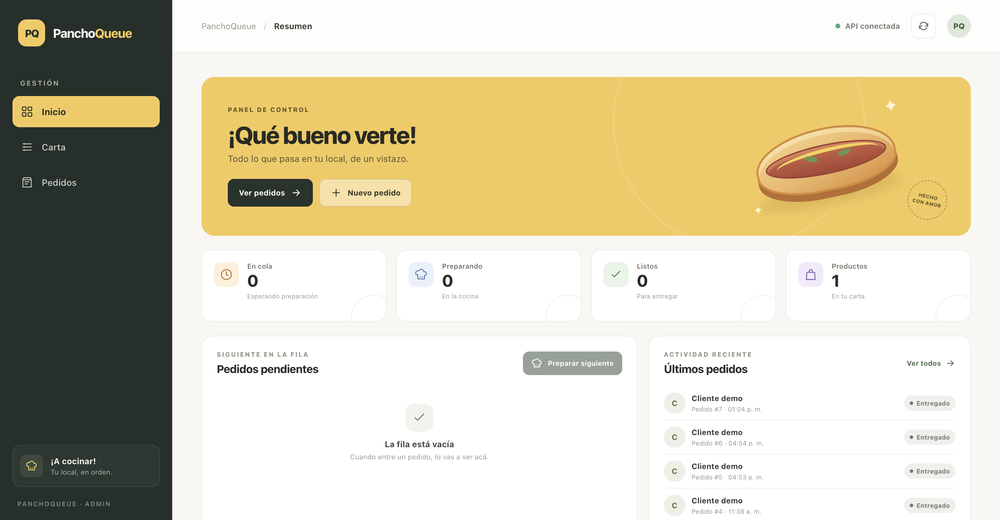
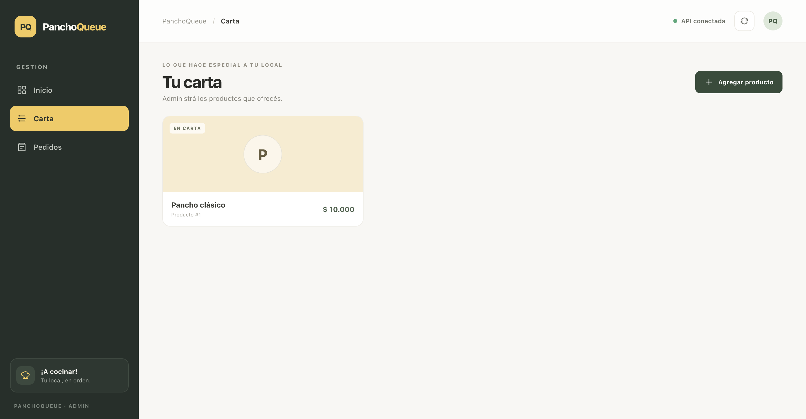
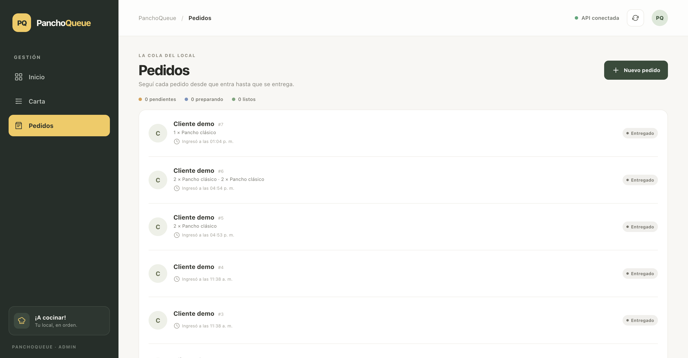

# 🌭 PanchoQueue — Frontend

Panel web para gestionar el menú y los pedidos del local PanchoQueue. Está
construido con React, TypeScript y Vite, y consume la API REST desarrollada con
Spring Boot.

🔗 Backend: [github.com/mryuto/panchoqueue](https://github.com/mryuto/panchoqueue)

## 🖥️ Capturas

### 🏠 Inicio

Resumen de pedidos pendientes, pedidos en preparación, pedidos listos y
productos. También muestra la cola y la actividad reciente.



### 🍔 Carta

Listado de productos y acceso al formulario para agregar productos.



### 🧾 Pedidos

Seguimiento de pedidos y sus estados. Los nombres de clientes en esta captura
se reemplazaron por datos genéricos.



## ✨ Funcionalidades

- Consulta productos de la carta y crea productos nuevos.
- Consulta pedidos e inicia el siguiente pedido pendiente de la cola.
- Crea pedidos con uno o varios productos.
- Avanza pedidos de `PREPARANDO` a `LISTO` y de `LISTO` a `ENTREGADO`.
- Muestra el estado de conexión con la API y los errores de carga.
- Diseño adaptable a pantallas de escritorio y móviles.

## 🧰 Tecnologías

- React y TypeScript
- Vite
- API REST con Spring Boot

## 📋 Requisitos

- Node.js y npm
- Backend PanchoQueue disponible en `http://localhost:8080`
- Para ejecutar el backend, consultar sus requisitos de Java y PostgreSQL en el
  [repositorio del backend](https://github.com/mryuto/panchoqueue).

## 🚀 Instalación y ejecución

```bash
npm install
npm run dev
```

En desarrollo, Vite reenvía las solicitudes `/api` a `http://localhost:8080`.
Iniciá el backend antes de usar las funciones que consultan o modifican datos.

## 📜 Comandos

| Comando | Descripción |
| --- | --- |
| `npm run dev` | Inicia el servidor de desarrollo |
| `npm run build` | Verifica TypeScript y genera la versión de producción en `dist/` |
| `npm run preview` | Previsualiza la versión de producción |
| `npm run lint` | Ejecuta ESLint |

## 🤖 Asistencia con IA

Desarrollado con asistencia de GitHub Copilot SDK en VS Code. El modelo usado
en esta sesión fue **`gpt-6-luna`**.
